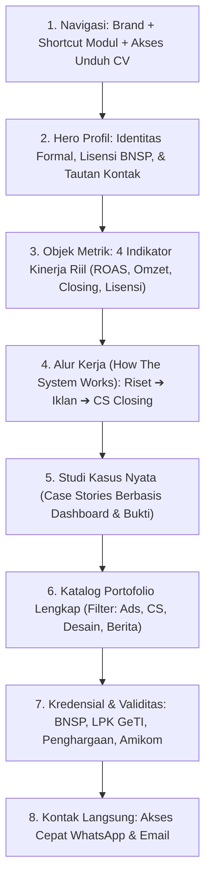

# 📋 Cetak Biru Perencanaan Website Profil Profesional: Nessa Kamalika
## *Pendekatan Storytelling Berbasis Objek, Data Riil, dan Alur Kerja Operasional*

Dokumen ini merinci perencanaan komprehensif pembuatan website portofolio profesional Nessa Kamalika. Perencanaan ini menggunakan pendekatan **storytelling yang berpusat pada objek kerja nyata**—menceritakan bagaimana data, alur operasional, dan materi komunikasi saling terhubung menghasilkan nilai bisnis tanpa menggunakan frasa hiperbola.

---

## 📖 1. Narasi Profil: Menghubungkan Tiga Objek Kerja

Alih-alih membuat klaim subjektif, narasi profil dibangun dari keterhubungan nyata antara tiga instrumen kerja yang dikelola oleh Nessa:

```
[INSTRUMEN 1: ANGGARAN & IKLAN] ──► [INSTRUMEN 2: ALUR OPERASIONAL CS] ──► [INSTRUMEN 3: REKAPITULASI OMZET]
  Meta, Shopee, & TikTok Ads          Whiteboard, SOP, & Chat WA               Laporan Keuangan & ROAS
```

### Narasi Utama (Fokus Objek):
> *"Sebuah kampanye pemasaran tidak selesai ketika audiens mengklik tombol iklan. Keberhasilan penjualan ditentukan oleh apa yang terjadi setelahnya: bagaimana pesan iklan dipahami, bagaimana lead disambut di meja percakapan Customer Service, dan seberapa disiplin alur tindak lanjut (follow-up) dijalankan.*  
>  
> *Latar belakang jurnalisme di Harian Republika melatih disiplin verifikasi fakta dan riset pesan. Pengalaman mengelola Meta & Shopee Ads melatih efisiensi alokasi biaya per klik. Sementara supervisi tim Customer Service di CV Creaidea Innovation memastikan setiap lead yang masuk ditangani secara terstruktur hingga menghasilkan transaksi riil."*

---

## 🏛️ 2. Arsitektur Informasi Halaman (Ramping & Bebas Data Kosong)

Struktur disusun mengalir dalam satu halaman dinamis (*single-page narrative*), mengeliminasi bagian tanpa data:



---

## 📊 3. Cerita di Balik 4 Objek Studi Kasus (Object-Driven Case Stories)

Setiap studi kasus menceritakan **kondisi objek awal**, **tindakan teknis yang diambil**, dan **hasil pencatatan akhir**:

### Studi Kasus 1: Skalabilitas Iklan Berbayar — Produk Kesehatan Herbal (Meta Ads)
* **Objek yang Diamati**: Dashboard Meta Ads Manager, grafik biaya per perolehan lead (Cost per Lead), dan laporan harian spend vs ROAS.
* **Tantangan Lapangan**: Biaya perolehan lead cenderung meningkat saat anggaran harian dinaikkan (*ad fatigue* pada audiens interest herbal standar).
* **Tindakan Teknis**:
  1. Merestrukturisasi set iklan menjadi tiga tingkatan: pengujian materi kreatif (video testimoni vs statis), audiens lookalike 1–3%, dan penargetan broad berbasis lokasi perkotaan.
  2. Melakukan evaluasi metrik CTR tautan dan frekuensi harian.
* **Hasil Tercatat**: Menjaga stabilitas **ROAS pada rentang 4.6x – 6.2x** dengan alokasi biaya harian yang terkontrol.

---

### Studi Kasus 2: Pengembangan Toko Baru — Pusat Herbal Indonesia (Shopee Ads)
* **Objek yang Diamati**: Seller Centre Shopee, metrik impresi pencarian kata kunci, tingkat klik (CTR), dan grafik omzet penjualan toko.
* **Tantangan Lapangan**: Membangun riwayat ulasan (*review*) dan visibilitas organik pada toko marketplace baru di tengah kompetisi kategori herbal yang padat.
* **Tindakan Teknis**:
  1. Memasang iklan kata kunci bertarget spesifik (nama keluhan & manfaat) dengan bid terjadwal pada jam sibuk pembeli (11.00–14.00 dan 19.00–21.00).
  2. Mengoptimalkan performa chat otomatis agar tingkat respon toko tetap berada di atas 90%.
* **Hasil Tercatat**: Membukukan akumulasi penjualan **Rp 100.000.000 dalam 6 bulan pertama**, mempertahankan rating toko pada angka **4.8/5.0**, dan ekspansi ke toko cabang kedua (*Pusat Herbal Asia*).

---

### Studi Kasus 3: Supervisi Operasional & Standarisasi CS — CV Creaidea Innovation
* **Objek yang Diamati**: Whiteboard koordinasi tugas, jadwal piket shift operasional, lembar evaluasi harian, dan rasio redirect lead WhatsApp.
* **Tantangan Lapangan**: Lead yang dikirimkan oleh tim periklanan berpotensi terbuang jika penanganan chat lambat atau respon staf tidak konsisten.
* **Tindakan Teknis**:
  1. Menyusun modul panduan penanganan keberatan (*objection handling script*) untuk mengantisipasi pertanyaan pelanggan terkait harga dan pengiriman.
  2. Membagi tugas 5 staf CS dalam jadwal respons terjadwal guna menangani volume **80–120 pesan harian** tanpa penumpukan antrean.
  3. Menggelar sesi evaluasi harian di depan whiteboard untuk mencocokkan kendala lead dengan targeting tim iklan.
* **Hasil Tercatat**: Mencapai rekor **Closing Rate divisi sebesar 87%** (melampaui target standar 75%), meningkatkan omzet bulanan divisi sebesar **20%–25%**, dan menerima penghargaan **Best Customer Service Performance (2024)**.

---

### Studi Kasus 4: Investigasi Lapangan & Verifikasi Publik — Harian Republika
* **Objek yang Diamati**: Naskah peliputan berita, wawancara narasumber langsung di lapangan, dan arsip publikasi cetak/daring.
* **Tantangan Lapangan**: Mengumpulkan data berimbang dari berbagai pihak di tengah dinamika isu sosial dan tenggat waktu (*deadline*) redaksi yang ketat.
* **Tindakan Teknis**:
  1. Turun ke lokasi peristiwa di Daerah Istimewa Yogyakarta untuk wawancara primer (Aksi Mahasiswa UII, Relokasi PKL Malioboro, Konferensi Internasional UGM).
  2. Menyusun fakta lapangan menjadi naskah berita yang memenuhi kaidah 5W+1H dan kode etik jurnalistik.
* **Hasil Tercatat**: **10 Artikel berita terbit resmi** di portal daring nasional *Republika Jogja* dan tayangan video di *Republika TV*.

---

## 🗂️ 4. Spesifikasi Objek Portofolio & Bukti Fisik

Setiap item portofolio di website memiliki tautan atau dokumen fisik yang dapat diakses langsung oleh pengunjung:

| Kategori | Nama Objek / Deliverable | Bukti Fisik yang Ditautkan |
| :--- | :--- | :--- |
| **Iklan Digital** | Kampanye Meta Ads Herbal Health | `assets/images/ads_meta_1.jpeg` (Laporan Spend & ROAS) |
| **Iklan Digital** | Penjualan Shopee Pusat Herbal | `assets/images/ads_shopee_1.png` (Dashboard Omzet Seller Centre) |
| **Iklan Digital** | Kampanye TikTok Ads Hap Hap Snack | `assets/images/ads_tiktok_1.png` (Dashboard Kampanye Iklan) |
| **Operasional CS** | Laporan Monitoring Closing Rate CS | `assets/images/cs_dashboard_1.jpeg` (Tabel Performa Harian) |
| **Operasional CS** | Dokumentasi Alur Koordinasi Tim | Foto Whiteboard & Timetable Operasional 5 Staf |
| **Desain Grafis** | Poster Matchday Premier League | `assets/images/design_poster_1.jpg` (Berkas High-Resolution) |
| **Desain Grafis** | Poster Juara Triple Winner Stadium | `assets/images/design_poster_2.jpg` (Berkas High-Resolution) |
| **Jurnalistik** | 10 Liputan Berita Media Nasional | Tautan langsung ke portal resmi *rejogja.republika.co.id* |
| **Kreatif Video** | Asisten Sutradara Video Musik | Tautan video musik resmi di YouTube (*Langit Sore*) |
| **Kredensial** | Sertifikat Kompetensi BNSP | `assets/images/sertifikat_bnsp.jpg` (No. Reg `M 1962 01525 2024`) |
| **Kredensial** | Sertifikat Pelatihan LPK GeTI | `assets/images/sertifikat_geti.jpg` (Lisensi Pemasaran Daring) |
| **Pendidikan** | Ijazah & Transkrip Amikom | IPK 3.81 (Cumlaude / Wisudawan Terbaik) |
| **Resume Dokumen** | Curriculum Vitae Resmi | `assets/docs/cv.pdf` (Tautan unduh langsung di navbar) |

---

## 🎨 5. Tampilan Visual & Kebutuhan UI/UX

* **Gaya Terpilih**: `tech-glossy` (Dark Mode berlatar `#080a10` dengan kartu `#0f131d` semi-transparan).
* **Fungsi Visual**: Warna gelap memberikan fokus maksimal pada tangkapan layar dashboard iklan yang penuh grafik warna-warni dan data metrik.
* **Aksen Warna**: `cyan` (`#38bdf8`) digunakan secara fungsional untuk tombol unduh, penanda status aktif, dan indikator persentase.
* **Tipografi**:
  * Judul Modul: Google Fonts *Outfit* (jelas dan formal).
  * Teks Data & Cerita: Google Fonts *Plus Jakarta Sans* (keterbacaan optimal untuk paragraf studi kasus).
* **Interaktivitas Lightbox**: Seluruh dokumen sertifikat BNSP dan laporan dashboard iklan dapat diklik untuk diperbesar ke ukuran asli tanpa meninggalkan halaman.

---

## 🚀 6. Langkah Penerapan Teknis ke Mesin

1. **Pembaruan Berkas Data (`data/profile.js`)**:
   Memasukkan narasi profil, parameter metrik, dan rincian keempat studi kasus di atas ke dalam struktur JSON mesin.
2. **Pengujian Tautan & Modal**:
   Memastikan 10 tautan Republika, tautan YouTube, berkas CV PDF, dan modal pembesar gambar berfungsi normal.
3. **Penyimpanan Git**:
   Melakukan commit revisi cetak biru ini ke repositori lokal dan melakukan push ke repositori GitHub.
