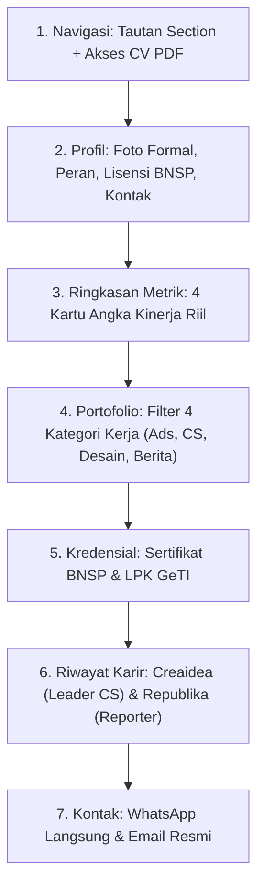

# 📋 Rencana Pembuatan Website Profil Profesional: Nessa Kamalika

Dokumen ini memuat spesifikasi struktur, konten faktual, dan alur kerja pembuatan website profil profesional Nessa Kamalika dengan pendekatan objektif dan berbasis data riil.

---

## 🎯 1. Informasi Profil & Fokus Peran

* **Nama Lengkap**: Nessa Kamalika
* **Pendidikan**: S1 Ilmu Komunikasi, Universitas Amikom Yogyakarta (IPK 3.81 / Wisudawan Terbaik)
* **Peran Utama**: Digital Advertiser & Customer Service Team Leader
* **Sertifikasi Profesi**: BNSP Pemasaran Daring (No. Reg. `M 1962 01525 2024`, berlaku s/d Maret 2027)
* **Deskripsi Objektif**:  
  Praktisi komunikasi dan pemasaran digital dengan pengalaman kerja mengelola kampanye iklan berbayar (Meta, Shopee, TikTok Ads), memimpin operasional tim Customer Service, serta memproduksi konten visual dan publikasi jurnalistik.

---

## 📊 2. Rekapitulasi Data & Metrik Riil

Seluruh angka di bawah ini bersumber langsung dari rekapitulasi data kerja di folder dokumen:

| Indikator Kinerja (KPI) | Nilai / Data Riil | Sumber Berkas |
| :--- | :--- | :--- |
| **ROAS Iklan Berbayar** | 4.8x – 6.2x | Dashboard Meta Ads (Laporan Spend & ROAS Herbal Health) |
| **Omzet Toko Marketplace** | Rp 100.000.000 (6 bulan pertama) | Shopee Ads (Pusat Herbal Indonesia) |
| **Closing Rate CS** | 87% (Standar divisi: 75%) | Laporan Evaluasi Harian CV. Creaidea Innovation |
| **Skala Tim CS** | 5 Staf Customer Service | Dokumentasi Timetable & Jadwal Operasional |
| **Volume Lead Harian** | 80 – 120 inquiries / hari | Laporan Harian Lead Redirect WhatsApp |
| **Publikasi Media Massa** | 10 Berita Terverifikasi | Harian Republika DIY (Februari – Agustus 2024) |
| **Penghargaan Kerja** | *Best Customer Service Performance (2024)* | CV. Creaidea Innovation |

---

## 🏛️ 3. Arsitektur Struktur Halaman

Halaman disusun dalam 7 modul struktural tanpa elemen dekoratif berlebih:

---

## 📁 4. Rincian Objek Portofolio yang Ditampilkan

### Kategori A: Digital Advertising (Paid Traffic)
1. **Meta Ads — Produk Herbal Health**: Laporan pembagian budget, testing interest, dan ROAS 4.6x.
2. **Shopee Ads — Pusat Herbal Indonesia**: Optimasi kata kunci pencarian dan iklan produk serupa.
3. **TikTok Ads — F&B Hap Hap Snack**: Penggunaan video format vertikal untuk audiens konsumsi ringan.
4. **Meta Ads — Biro Perjalanan Dewanta Trans**: Kampanye lead generation jasa transportasi pariwisata.

### Kategori B: Customer Service & Operasional Tim
1. **Dashboard Monitoring Lead**: Pencatatan konversi harian dan evaluasi follow-up chat WhatsApp.
2. **SOP & Koordinasi Tim**: Whiteboard jadwal kerja, monitoring closing rate, dan pembagian shift 5 staf.
3. **Bukti Apresiasi Performa**: Catatan pencapaian closing rate 87% dan bukti pengakuan manajemen.

### Kategori C: Desain Grafis Komersial
1. **Poster Pertandingan (Matchday)**: Desain publikasi olahraga format cetak dan digital media sosial.
2. **Poster Kejuaraan (Championship)**: Desain perayaan kemenangan tim sepak bola.
3. **Materi Promosi Pendaftaran**: Poster open registration Football Academy.

### Kategori D: Publikasi Jurnalistik & Media
1. **10 Liputan Berita Republika**:
   * Liputan Solidaritas Bela Palestina di UII.
   * Liputan Isu Pendidikan (Sekolah Tanpa Gawai, Edukasi Perawatan Rambut UGM).
   * Liputan Isu Ekonomi Lokal (Relokasi PKL Malioboro).
   * Liputan Konferensi Internasional AAS-in-Asia 2024 di UGM.
2. **Produksi Video**: Asisten Sutradara pada video musik *Langit Sore — Cinta Hanya Cerita Luka* (YouTube).

---

## 🎨 5. Spesifikasi Tampilan Visual

* **Preset Gaya**: `tech-glossy` (Dark Mode bersih dengan kontras teks tinggi).
* **Warna Aksen**: `cyan` (`#38bdf8`) untuk elemen penanda tautan dan tombol.
* **Tipografi**:
  * Judul: Google Fonts *Outfit* (jelas, tegas).
  * Teks Isi: Google Fonts *Plus Jakarta Sans* (keterbacaan tinggi untuk data dan deskripsi).
* **Prinsip Tampilan**: Faktual, rapi, minim ornamen, fokus pada gambar bukti dan angka metrik.

---

## 🛠️ 6. Tahapan Eksekusi

1. **Sinkronisasi Data**: Memasukkan data faktual di atas ke dalam `data/profile.js`.
2. **Penyusunan Aset**: Memastikan 22 berkas gambar pendukung siap di `assets/images/`.
3. **Verifikasi Tautan**: Menguji tautan WhatsApp, berkas CV PDF, dan 10 URL artikel Republika.
4. **Penyelarasan Git**: Commit berkas ke repositori lokal dan push ke GitHub.
