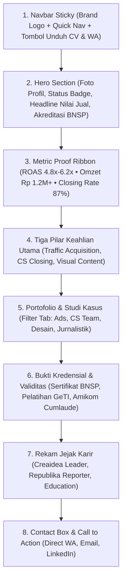

# 📋 Cetak Biru Perencanaan Website Profil Profesional: Nessa Kamalika

Dokumen ini merinci rencana strategis, arsitektur informasi, positioning karir, hingga roadmap eksekusi pembuatan website portofolio profesional berdaya konversi tinggi untuk **Nessa Kamalika**.

---

## 🎯 1. Positioning Strategis & Value Proposition

### Tantangan Utama
Nessa memiliki keahlian di 4 bidang: *Digital Advertising*, *Customer Service Leadership*, *Desain Grafis*, dan *Jurnalistik*. Menampilkannya secara terpisah berisiko membuat calon klien/rekruter menganggapnya "kurang fokus".

### Solusi Narasi (Positioning Framing)
Posisikan Nessa sebagai:
> **"Full-Funnel Growth Marketer & Revenue Operations Leader"**  
> *"Praktisi langka yang menguasai rantai konversi bisnis hulu-ke-hilir: mulai dari riset pasar & materi visual, eksekusi iklan berbayar (Meta/Shopee/TikTok Ads), hingga memimpin tim Customer Service dalam menutup penjualan (closing sales)."*

### Target Audiens Utama (User Personas)
1. **Business Owner / CEO Brand D2C & UMKM**: Mencari praktisi yang bisa meningkatkan omzet riil dan menjaga ROAS iklan tetap sehat.
2. **Head of Growth / Marketing Lead di Agensi**: Membutuhkan advertiser berbasis data dengan pemahaman audiens, copywriting, dan analitik.
3. **HR & Recruiter Korporat**: Membutuhkan bukti kredibilitas legalitas (Sertifikat BNSP, predikat Cumlaude Amikom IPK 3.81).

---

## 🏛️ 2. Arsitektur Informasi & Alur Halaman (Page Structure)



---

## 📑 3. Rincian Konten Tiap Bagian

### 1. Hero Section
* **Badge Status**: `🟢 Tersedia untuk Pekerjaan Full-Time & Konsultasi Growth`
* **Headline**: Nessa Kamalika — *Full-Funnel Growth Marketer & Revenue Operations Leader*
* **Sub-headline**: Menghubungkan strategi iklan berbayar berperforma tinggi dengan sistem kepemimpinan tim CS berkonversi maksimal.
* **Trust Badges**:
  * 🏅 Wisudawan Terbaik Amikom (IPK 3.81 Cumlaude)
  * 📜 Lisensi BNSP Digital Marketing Resmi (No. Reg `M 1962 01525 2024`)
* **Tombol Aksi**: `Lihat Hasil Proyek` & `Unduh Resume (PDF)`

---

### 2. Metric Proof Ribbon (Social Proof Kuantitatif)
Menampilkan 4 angka pencapaian penting untuk membangun kepercayaan instan dalam 3 detik pertama:
1. **4.8x – 6.2x** — Rata-rata ROAS Iklan Berbayar (Meta & TikTok Ads).
2. **Rp 1.2 Miliar+** — Total Omzet Toko & Akumulasi Penjualan Dikelola.
3. **87%** — Rekor Closing Rate Tertinggi Tim Customer Service (Target: 75%).
4. **10 Artikel** — Karya Jurnalistik Terverifikasi di Harian Republika.

---

### 3. Tiga Pilar Solusi (Core Growth Pillars)
Menjelaskan bagaimana 3 kompetensi Nessa saling menguatkan alur bisnis:
* **Pilar 1: Paid Acquisition (Iklan Berbayar)**
  * *Tools*: Meta Ads Manager, Shopee Ads, TikTok Ads.
  * *Output*: Targeting terukur, riset audiens, testing materi kreatif, dan scaling budget efisien.
* **Pilar 2: Conversion & Team Operations (Customer Service)**
  * *Tools*: CRM, SOP Tim, Objection Handling, Lead Pipeline.
  * *Output*: Rekrutmen & supervisi 5 staf CS, pemetaan kendala closing, dan peningkatan omzet tim 25%.
* **Pilar 3: Creative Communication (Desain & Copywriting)**
  * *Tools*: Adobe Photoshop, Canva, Riset Jurnalistik.
  * *Output*: Poster olahraga energik, copy iklan berdaya bujuk tinggi, dan narasi berita publikasi nasional.

---

### 4. Portofolio Proyek Interaktif (Filter Tabs)
Dikelompokkan ke dalam 4 tab interaktif:

| Kategori | Proyek yang Ditampilkan | Bukti Visual (Screenshot) |
| :--- | :--- | :--- |
| **Digital Advertising** | • Meta Ads — Skala Produk Herbal Health (ROAS 4.6x)<br>• Shopee Ads — Toko Pusat Herbal (Omzet Rp 100jt)<br>• TikTok Ads — F&B Hap Hap Snack & Fashion Raraya | Tangkapan layar dashboard asli FB Ads, Shopee Ads, dan TikTok Ads |
| **CS Leadership** | • Dashboard Monitoring Closing Rate CS (Juni 2025)<br>• Dokumentasi Timetable & Whiteboard Koordinasi Tim<br>• Laporan Omzet Harian Divisi CS | Bukti chat apresiasi closing, whiteboard strategi, dan diagram omzet |
| **Desain Grafis** | • Matchday Premier League Sports Poster<br>• Championship Triple Winner Celebration Poster<br>• Football Academy Open Registration | Berkas gambar resolusi tinggi poster olahraga profesional |
| **Karya Jurnalistik** | • Liputan Aksi Bela Palestina di UII (Republika)<br>• Liputan Pendidikan, UMKM, dan Isu Sosial DIY<br>• Asisten Sutradara Video Musik (YouTube) | Tautan berita langsung ke portal Republika & video YouTube |

---

### 5. Sertifikasi & Validitas Legalitas
* **Sertifikat BNSP**: Pemasaran Daring (Masa berlaku 2024 – 2027) lengkap dengan nomor lisensi dan modal pembesar gambar (*lightbox*).
* **Pelatihan GeTI Incubator**: Sertifikat Pemasaran Daring Profesional.
* **Penghargaan Kerja**: *Best Customer Service Performance 2024* (CV Creaidea Innovation).

---

### 6. Kontak & Pemicu Konversi (Call to Action)
* **Pesan Utama**: *"Siap Meningkatkan Konversi dan Efisiensi Bisnis Anda?"*
* **Tautan Langsung**:
  * WhatsApp Direct: `+62 878-3420-3959`
  * Email Resmi: `nessakamalika@gmail.com`
  * Profil LinkedIn: `linkedin.com/in/nessa-kamalika`

---

## 🎨 4. Rekomendasi Art Style & Identitas Visual

Untuk profil Nessa, direkomendasikan gaya:
* **Gaya Terpilih**: **`tech-glossy`** *(Default)* dengan opsi alternatif **`warm-editorial`**.
* **Alasan Pemilihan**:
  1. *Tech Glossy* memberikan kesan modern, analitis, dan sangat cocok dengan dashboard metrik periklanan digital.
  2. Aksen **Cyan Glow** (`#38bdf8`) atau **Emerald Growth** (`#10b981`) melambangkan pertumbuhan profit (*growth & revenue*).
  3. Tipografi **Outfit** (modern sans display) mencerminkan ketegasan eksekutif muda berprestasi.

---

## 🚀 5. Roadmap 4 Langkah Eksekusi Teknis

```text
[Langkah 1: Sinkronisasi Data]
  Tuangkan seluruh data riil ke dalam file: data/profile.js
  (Nama, nomor WA, sertifikat BNSP, link berita Republika, dan seluruh proyek)
       │
       ▼
[Langkah 2: Migrasi Aset Gambar Lengkap]
  Salin 22 gambar bukti dashboard dari PORTOFOLIO_NESSA ke assets/images/
       │
       ▼
[Langkah 3: Pengujian Interaksi & Pratinjau Lokal]
  Uji lightbox modal, responsive mobile view, dan uji tombol kontak WA & CV
       │
       ▼
[Langkah 4: Deploy & Git Sync]
  Commit perubahan ke repositori GitHub dan siap meluncur ke Vercel!
```
