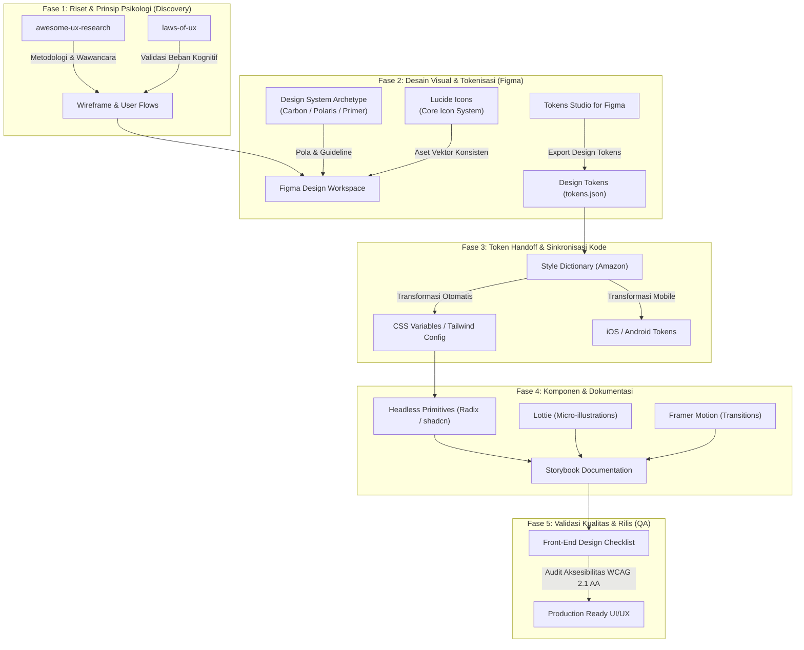

# 🚀 Strategi & Arsitektur Terpadu UI/UX Design System

Dokumen ini memetakan, mengintegrasikan, dan menyelesaikan tumpang tindih (*overlap*) antar repositori dan sumber daya UI/UX, sehingga terbentuk satu alur kerja (*pipeline*) terpadu yang efisien, konsisten, dan minim friksi dari riset hingga kode produksi.

---

## 🗺️ 1. Peta Relasi Alur Kerja (End-to-End Pipeline)

Diagram di bawah ini menunjukkan bagaimana setiap repositori berperan dalam rantai nilai (*value chain*) produk digital:



---

## ⚖️ 2. Resolusi Tumpang Tindih & Konflik (Conflict Matrix)

Ketika banyak repositori dan alat dikumpulkan tanpa tata kelola, sering terjadi kebingungan (*redundancy*). Berikut adalah pemilahan batas kerja (*boundaries*) dan aturan mainnya:

| Area | Potensi Tumpang Tindih / Konflik | Solusi & Aturan Kerja (Governance Rule) |
| :--- | :--- | :--- |
| **Design System Reference** | Mengadopsi terlalu banyak sistem sekaligus (misal: mencampur gaya Carbon, Polaris, dan Material) sehingga antarmuka tidak konsisten (*Frankenstein UI*). | **Pilih 1 Archetype Utama per Domain:**<br>• *Enterprise & Big Data*: Acu **Carbon Design System**.<br>• *E-Commerce & SaaS Transaksional*: Acu **Shopify Polaris**.<br>• *Dev-Tools / Modern Web App*: Acu **GitHub Primer**.<br>Gunakan yang lain hanya sebagai studi banding pola interaksi tertentu. |
| **Icon Libraries** | Menggabungkan Lucide, Tabler, dan Material Icons dalam satu layar sehingga ketebalan stroke (*stroke-width*) dan *optical weight* tidak seragam. | **Aturan 1 Master Icon Set:**<br>• Standarisasi 100% icon sistem pada **Lucide Icons** (grid 24x24px, stroke 2px).<br>• **Simple Icons** hanya digunakan khusus untuk logo brand/pihak ketiga (Google, Apple, GitHub, dll.).<br>• Larang mencampur Tabler dan Lucide dalam satu proyek. |
| **Design Tokens vs Manual Styling** | Desainer mengubah warna/spasi di Figma, developer mengubah nilai hex di CSS secara manual (terjadi *design drift*). | **Single Source of Truth (SSOT):**<br>Semua nilai token hanya boleh diubah di **Tokens Studio (Figma)**, di-commit ke Git sebagai JSON, lalu dibuild otomatis oleh **Style Dictionary** menjadi variabel kode. Developer dilarang meng-hardcode nilai hex/pixel. |
| **Animasi & Interaksi** | Menggunakan Lottie untuk semua interaksi mikro sehingga ukuran bundle membengkak dan performa lambat. | **Pemisahan Peran Animasi:**<br>• **Framer Motion / CSS Native**: Untuk interaksi struktural UI (modal transition, accordion, dropdown, hover, tab sliding) durasi < 300ms.<br>• **Lottie**: Hanya untuk *onboarding splash, empty-state illustration, celebration checkmark, loading complex vector*. |
| **Evaluasi Kualitas vs Riset** | Melakukan audit heuristik terlambat (saat kode sudah jadi) atau melakukan checklist frontend saat masih tahap sketsa. | **Phase-Gating (Pemisahan Waktu):**<br>• **Laws of UX**: Dipakai di *awal* (tahap Wireframe & Sketsa) untuk menguji struktur kognitif.<br>• **Front-End Checklist**: Dipakai di *akhir* (tahap Handoff & Staging) untuk menguji rasio kontras warna, keyboard navigation, dan responsivitas. |

---

## 📋 3. Standar Operasional Prosedur (SOP) 4 Fase Kerja

### Fase 1: Discovery & Validasi Psikologi
1. **Riset Kebutuhan Pengguna:** Gunakan kerangka wawancara dan riset dari [`awesome-ux-research`](https://github.com/steven2358/awesome-ux-research).
2. **Uji Heuristik Desain Awal:** Evaluasi wireframe terhadap prinsip [`laws-of-ux`](https://github.com/jonyablonski/laws-of-ux):
   - *Fitts's Law*: Apakah target sentuh/klik tombol utama mudah dijangkau?
   - *Hick's Law*: Apakah opsi navigasi tidak membingungkan pengguna?
   - *Miller's Law*: Apakah data di-chunking ke dalam kelompok-kelompok logis?

### Fase 2: Pembangunan Desain Visual & Token
1. **Penerapan Token:** Tentukan skala tipografi, spasi (kelipatan 4px/8px), dan palet warna semantik (*Primary, Neutral, Destructive, Warning, Success*) di Figma.
2. **Library Vektor:** Pasang library [`lucide-icons`](https://github.com/lucide-icons/lucide) sebagai komponen utama icon set.
3. **Sinkronisasi Token:** Export token menggunakan [`Tokens Studio`](https://github.com/tokens-studio/figma-plugin) ke branch repositori Git proyek.

### Fase 3: Integrasi Teknis & Design-to-Code
1. **Eksekusi Build:** Jalankan [`style-dictionary`](https://github.com/amzn/style-dictionary) untuk mengompilasi `tokens.json` menjadi CSS variables atau Tailwind theme extension.
2. **Komposisi Komponen:** Gunakan pola aksesibel dari [`radix-ui/primitives`](https://github.com/radix-ui/primitives) atau [`shadcn-ui`](https://github.com/shadcn-ui/ui) agar state ARIA (*expanded, selected, focus-visible*) valid secara otomatis.
3. **Dokumentasi Terisolasi:** Tampilkan setiap varian komponen (*default, hover, active, disabled, loading*) di [`storybook`](https://github.com/storybookjs/storybook).

### Fase 4: QA, Aksesibilitas & Peluncuran
1. **Verifikasi Checklist:** Buka [`Front-End-Design-Checklist`](https://github.com/thedaviddias/Front-End-Design-Checklist) dan lakukan pengecekan:
   - Rasio kontras teks minimum 4.5:1 untuk teks normal (WCAG AA).
   - Indikator fokus keyboard (*focus ring*) terlihat jelas pada semua tombol dan link.
   - Target sentuh minimum 44x44px pada layar mobile.
2. **Persetujuan Handoff:** Desainer dan insinyur frontend memverifikasi bahwa hasil implementasi 100% sinkron dengan komponen di Storybook.

---

## 📂 4. Rekomendasi Struktur Folder Workspace Desain

Untuk menjaga agar workspace `/Users/hizbamuhammadabror/UI:UX DESIGNER/` ini rapi dan siap pakai, berikut struktur direktori yang disarankan:

```text
UI:UX DESIGNER/
├── 01_RESEARCH_AND_HEURISTICS/     # Hasil user interview, benchmark kompetitor, catatan Laws of UX
├── 02_DESIGN_TOKENS/              # File tokens.json, konfigurasi Style Dictionary, tema warna
├── 03_ASSETS_AND_ICONS/           # File SVG ekspor, Lucide icon config, animasi Lottie JSON
├── 04_COMPONENTS_DOCS/            # Spesifikasi komponen, Storybook stories, petunjuk handoff
├── 05_QA_AND_CHECKLISTS/          # Lembar uji aksesibilitas (WCAG) dan Front-End Checklist
├── REPOSITORI_UI_UX.md            # Katalog kurasi repositori referensi
└── STRATEGI_DAN_ARSITEKTUR_UIUX.md # Dokumen master strategi dan alur relasi kerja
```
